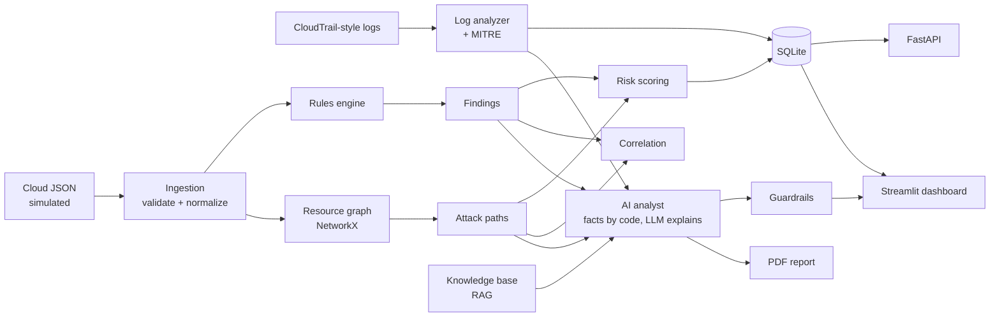

# CirrusSec

An AI-assisted **cloud security posture and attack-path analysis platform**. It analyses a simulated AWS environment, finds misconfigurations with deterministic rules, scores and correlates risk, maps **potential attack paths**, analyses CloudTrail-style activity, and uses RAG plus an optional LLM to explain findings and generate remediation guidance and a PDF report.

> **Core principle — deterministic detection + AI assistance.** Rules decide what is *true*. The AI only explains, prioritises and summarises. Every answer separates **FACT** (built by code) from **AI INTERPRETATION** and **RECOMMENDATION**, and model output passes through guardrails.

All data is **synthetic**. Nothing connects to a real AWS account.

## Quick start

```bash
pip install -r requirements.txt
python scripts/make_sample_logs.py   # (sample logs are already included)
python run.py scan                   # CLI summary
python run.py report                 # + PDF in data/reports/
python run.py dashboard              # Streamlit UI  → http://localhost:8501
python run.py api                    # FastAPI       → http://127.0.0.1:8000/docs
python -m pytest -q                  # 56 tests
```

Optional local LLM (otherwise a deterministic offline analyst is used): install [Ollama](https://ollama.com), `ollama pull llama3.1:8b`, then set `LLM_PROVIDER=ollama` in `.env`.

## What it does

| Capability | Where |
|---|---|
| Simulated cloud (EC2, S3, IAM users/roles, SGs, VPC, RDS, CloudTrail) | `data/cloud/novatech.json` |
| Safe, validated ingestion (size limits, ID allow-list, schema checks) | `ingestion/loader.py` |
| 10 security rules with evidence, severity, remediation, references | `rules/aws_rules.py` |
| Explainable risk score (severity + exposure + sensitivity + privileges + attack-path position, × confidence) | `risk_engine/scoring.py` |
| Resource graph (NetworkX) + potential attack paths + finding correlation | `attack_paths/graph.py` |
| CloudTrail-style activity analysis (brute force, persistence sequence, log tampering, burst reads, off-hours/untrusted IP) | `log_analyzer/analyzer.py` |
| MITRE ATT&CK mapping with limitations (not forced) | `log_analyzer/mitre.py` |
| RAG knowledge base (chunk → TF-IDF vectors → retrieve) | `rag/retriever.py`, `data/knowledge/` |
| AI analyst, chat, guardrails (injection, invented IDs, destructive commands, unsupported attack claims) | `ai/` |
| SQLite (scans, findings, paths, events, alerts, AI output, reports) + scan diff | `database/db.py` |
| FastAPI with optional API-key auth and input limits | `backend/api.py` |
| 10-page Streamlit dashboard | `dashboard/app.py` |
| Professional PDF report | `reports/pdf_report.py` |

### The rules

| ID | Rule | Severity |
|---|---|---|
| CSA-001 | SSH (22) open to the internet | HIGH |
| CSA-002 | Public S3 bucket | HIGH / CRITICAL if sensitive |
| CSA-003 | Overly permissive IAM policy (`*`, `service:*` on `*`) | HIGH / CRITICAL |
| CSA-004 | Unused active access key (> 90 days) | MEDIUM |
| CSA-005 | CloudTrail disabled / not multi-region / no validation | HIGH → LOW |
| CSA-006 | Database publicly accessible | HIGH / CRITICAL if sensitive |
| CSA-007 | Sensitive ports (DB/RDP/SMB…) or all traffic open to internet | HIGH / CRITICAL |
| CSA-008 | IAM user: console, broad permissions, no MFA | HIGH |
| CSA-009 | Missing encryption at rest (S3, RDS, EBS root) | MEDIUM / HIGH |
| CSA-010 | Internet-reachable instance holding IAM role credentials | MEDIUM |

## Architecture



Data flow: ingest → rules → findings → graph + attack paths → correlation → risk scoring (uses path position) → MITRE → activity analysis → persist → UI / API / AI / PDF.

## Demo scenario — NovaTech

`data/cloud/novatech.json` contains intentional weaknesses. Running the scan produces **13 findings (3 critical, 7 high, 3 medium), 4 potential attack paths, 9 activity alerts, posture score 38/100**.

Headline potential attack path:

```
internet → web-sg (SSH 0.0.0.0/0) → web-server-01 → web-server-role (s3:* on *) → customer-data (unencrypted, confidential)
```

Other paths: public `customer-backups` bucket, publicly reachable `customers-db`. The sample logs add a synthetic incident: failed logins → login from an untrusted IP → new `backup-admin` user + admin policy + access key → burst of reads from `customer-data` → security group opened → CloudTrail `StopLogging`.

Suggested demo (5–10 min): Overview → Findings → Finding Details (risk breakdown) → Attack Paths → AI Security Analyst ("Explain this attack path", "Which finding should I remediate first?") → Activity/Logs → Reports → Generate PDF.

## API

| Endpoint | Purpose |
|---|---|
| `GET /resources`, `/findings[?severity=]`, `/findings/{id}`, `/attack-paths`, `/events`, `/scans` | Read data |
| `POST /scan` | Scan default lab data, or the JSON body you send (≤ 1 MB, validated). Returns diff vs previous scan |
| `POST /analyze` | Re-run default analysis |
| `POST /ai/analyze` | Explain a `finding_id` / `path_id` / overall summary |
| `POST /ai/chat` | Ask the analyst a question (≤ 1000 chars) |
| `POST /report` → `GET /report/{id}` | Generate and download the PDF |

Set `API_KEY` to require an `X-API-Key` header.

## Security of the application itself

- Untrusted input: size limits, schema validation, resource-ID allow-list (blocks injection text in identifiers), safe JSON parsing.
- Prompt injection: question and environment text are sanitised/redacted; model gets data in delimited blocks marked untrusted; facts are never model-written.
- Output validation: unknown resource IDs flagged, destructive commands removed, "attack occurred" claims flagged when no activity evidence exists.
- SQL: parameterised queries only. No secrets in code (`.env`, `.env.example`). Container runs as non-root.
- Tested in `tests/` (malformed JSON, oversized input, malicious IDs, injection, invented resources, auth, validation).

## Limitations (be honest in interviews)

- Simulated data only; AWS integration (read-only `boto3` collector) is **not implemented**.
- IAM analysis does not evaluate conditions, permission boundaries, SCPs, resource policies or NotAction.
- Reachability is simplified (internet → SG → instance → role → data). No VPC routing/NACL/WAF modelling.
- Attack paths are *potential* and configuration-based; no exploitability or vulnerability assessment.
- Anomaly detection is rule/threshold based (trusted CIDRs, business hours, bursts); no statistical baseline.
- RAG uses local TF-IDF over short curated notes rather than ChromaDB + neural embeddings (the `Retriever` interface makes swapping straightforward). Knowledge notes are paraphrased summaries, not the official documents.
- CIS control numbers are approximate pointers — verify against your benchmark version.
- Authentication is a single shared API key; no user management.

## Future improvements

Read-only AWS collector (dedicated sandbox account, cost/permission precautions), ChromaDB + embeddings, more rules (IMDSv1, EBS snapshots, Lambda, KMS), IAM policy simulation, statistical anomaly baselines, richer graph visuals, scheduled scans, SSO.

## Tech stack

Python 3.12 · Pydantic · NetworkX · FastAPI · Streamlit · SQLite · ReportLab · pytest · (optional) Ollama · Docker · GitHub Actions.

## Project structure

```
core/         models + pipeline        ingestion/   loader/validation     rules/        engine + 10 rules
risk_engine/  scoring                  attack_paths/ graph, paths, correlation
log_analyzer/ activity analysis, MITRE rag/         retriever             ai/           analyst, llm, guardrails
database/     SQLite                   backend/     FastAPI               dashboard/    Streamlit
reports/      PDF                      tests/       56 tests              data/         cloud, logs, knowledge
docs/         learning log, interview prep, architecture notes             config/       settings
```

Docs: [docs/LEARNING_LOG.md](docs/LEARNING_LOG.md) · [docs/INTERVIEW_PREP.md](docs/INTERVIEW_PREP.md)
